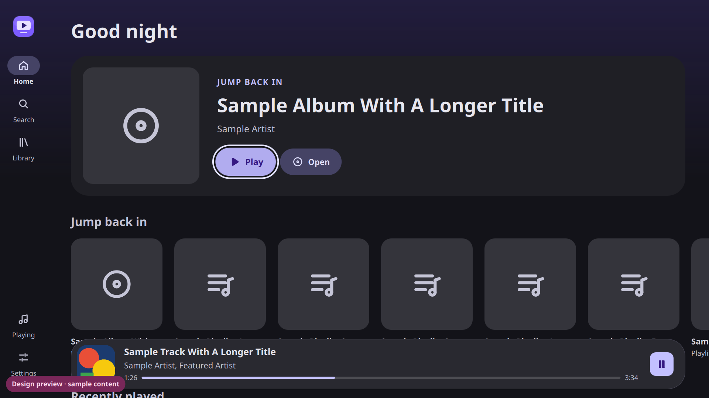
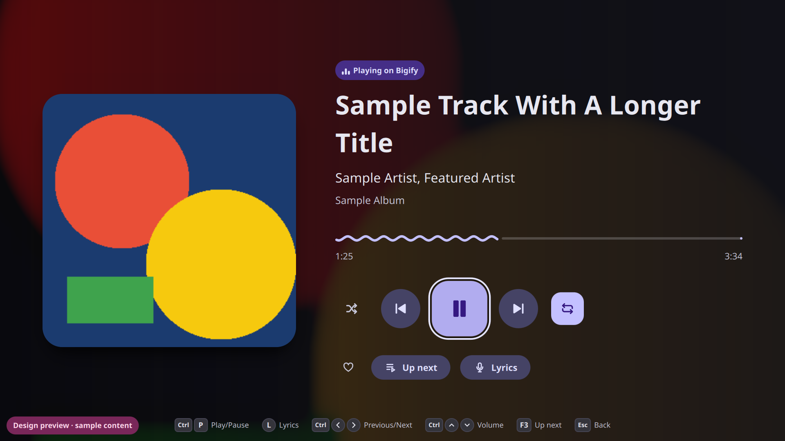
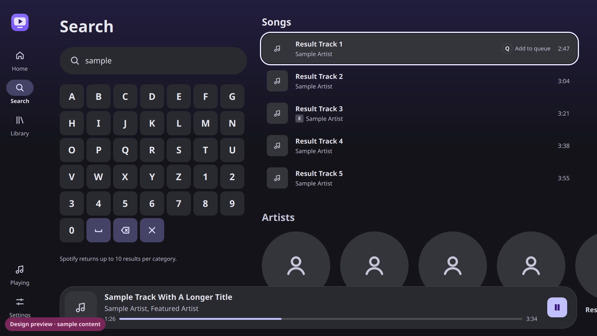
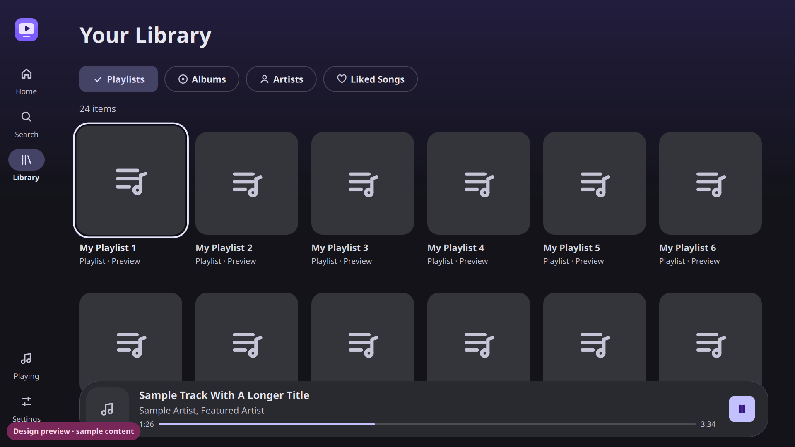

# Bigify

**A 10-foot, controller-first Spotify Connect client for Linux TVs, Steam
Machines and Steam Deck.** Built with Qt Quick and Rust, powered by
[librespot](https://github.com/librespot-org/librespot), and designed with
Material 3 Expressive for the living room.

> Bigify is an independent, community-developed open-source project. It is
> **not affiliated with, endorsed by or sponsored by Spotify**. A Spotify
> Premium account is required.

| | |
|---|---|
|  |  |
|  |  |

<sub>Screenshots from the built-in design preview (sample content).</sub>

## Status

**Pre-release (0.1, MVP).** It builds, runs, plays through librespot, and is
fully navigable with a controller. Real-account behaviour still needs field
testing; see the [manual test checklist](docs/DEVELOPMENT.md#manual-test-checklist).

## Features

- **Sign in from your phone.** Pick "Bigify" in the Spotify app's device list
  and nothing needs to be typed on the TV. Browser sign-in is also available.
- **Spotify Connect.** Bigify appears as a TV device, so you can control it
  from your phone or desktop as well as the couch.
- **Now Playing.** Large artwork, an expressive play/pause morph, wavy
  progress, shuffle, repeat, volume, and an "Up next" view of the queue.
- **Home.** Jump back in, recently played, your playlists, top artists and
  saved albums. Only real data from your account is shown, never invented
  recommendations.
- **Search and Library.** A D-pad keyboard for search, plus playlists,
  albums, artists and Liked Songs with on-demand paging.
- **Built for the TV.** A 1080p canvas scaled to any resolution (4K, Deck),
  title-safe margins, large text and an always-visible focus ring.
- **Dynamic color.** The interface is tinted from album art, with WCAG
  contrast guaranteed by tests.
- **Honest state.** Buttons reflect *confirmed* playback; pending requests
  show a loading indicator, and failures are reported.
- **Light on resources.** No polling, an idle controller costs no CPU, and
  images are decoded at display size.

See [docs/LIMITATIONS.md](docs/LIMITATIONS.md) for exactly what is and isn't
possible with today's Spotify interfaces.

## Controls

D-pad/stick to move · **A** select · **B** back · **X** play/pause · **Y** add
to queue · **LB/RB** previous/next · **LT/RT** volume · **Start** Now Playing
· **Select** Up next. Full details, keyboard equivalents and Steam Input tips:
[docs/CONTROLS.md](docs/CONTROLS.md).

## Install

A Flatpak bundle can be built with `ci/flatpak.sh` (see
[DEVELOPMENT.md](docs/DEVELOPMENT.md#flatpak)) and installed on SteamOS or
any Flatpak-enabled distribution:

```sh
flatpak install --user dist/bigify.flatpak
```

## Build

Requires Rust 1.90+, Qt 6.8+ and PulseAudio/ALSA/udev headers. Quick start
with Docker on any OS:

```sh
docker build -t bigify-dev -f ci/Dockerfile .
ci/run.sh cargo build --release
```

Native build instructions for Debian, Fedora and Arch/SteamOS:
[docs/DEVELOPMENT.md](docs/DEVELOPMENT.md).

## Important: how Bigify reaches Spotify

Playback, Connect and sign-in use librespot. Browse features (home, search,
library, queue) call the Spotify Web API with the access token of the
librespot session, because Spotify's 2026 developer rules limit a regular
developer app to five users. **This borrows Spotify's own client identity and
may be rate-limited or blocked by Spotify at any time.** Details and
alternatives: [ADR 0003](docs/adr/0003-web-api-access.md).

## Privacy and security

- No credentials are stored in the source or written to logs. librespot keeps
  reusable credentials in `$XDG_STATE_HOME/bigify/credentials.json` (mode
  0600); *Settings → Sign out* deletes it.
- Logs never contain tokens or search queries; token-handling modules are
  capped at `info`.
- Artwork is fetched only from Spotify's image CDN.

## Documentation

- [Architecture](docs/ARCHITECTURE.md) and [decision records](docs/adr/)
- [Design system](docs/DESIGN.md)
- [Controls and navigation](docs/CONTROLS.md)
- [Capabilities and limitations](docs/LIMITATIONS.md)
- [Development, testing and the design preview](docs/DEVELOPMENT.md)
- [Contributing](CONTRIBUTING.md)

## License

GPL-3.0-or-later. See [LICENSE](LICENSE) and [ADR 0004](docs/adr/0004-license.md).
librespot is MIT-licensed; Qt is used under the LGPL-3.0. "Spotify" is a
trademark of Spotify AB, used here only to describe compatibility.
