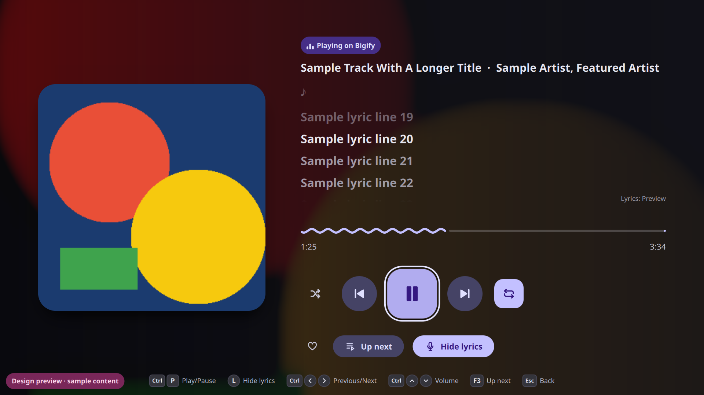

<div align="center">


# Bigify

**A 10-foot, controller-first Spotify Connect client for Linux TVs, Steam
Machines and Steam Deck.**

[](https://github.com/ShadowOkami4/bigify/actions/workflows/ci.yml)
[](https://github.com/ShadowOkami4/bigify/releases)
[](LICENSE)


[Install](#install) · [Features](#features) · [Controls](#controls) ·
[Build](#build-from-source) · [Documentation](#documentation)

<a href="https://ko-fi.com/W7W31TOGEY"></a>

</div>

<p align="center">
  
</p>

Bigify is built with Qt Quick and Rust, plays through
[librespot](https://github.com/librespot-org/librespot), and follows Material 3
Expressive, adapted for the living room: large type, title-safe margins, an
always-visible focus ring and nothing that needs a mouse.

> [!NOTE]
> Bigify is an independent, community-developed open-source project. It is
> **not affiliated with, endorsed by or sponsored by Spotify**. A Spotify
> Premium account is required.

## About this project

I'm still learning Rust, and I needed this app for a party, so I built it
with a lot of help from LLMs (AI coding assistants). It works and I use it,
but expect rough edges and possibly bugs. As I get more experienced I plan to
keep Bigify maintained and to understand and improve every part of it
myself. Bug reports and pull requests are very welcome; see
[Contributing](CONTRIBUTING.md).

## Screenshots

| Home | Search |
|---|---|
|  |  |
| **Library** | **Lyrics** |
|  |  |

<sub>Captured from the built-in design preview with sample content.</sub>

## Features

**Playback**
- **Spotify Connect.** Bigify appears as a TV device, so you can hand music
  over from your phone and keep controlling it from there.
- **Sign in from your phone.** Pick "Bigify" in the Spotify app's device list;
  nothing has to be typed on the TV. Browser sign-in is available too.
- **Immersive Now Playing.** Large artwork over a blurred backdrop, wavy
  progress and an expressive play/pause. After a few seconds the controls fade
  away and only the music is left on screen.
- **Synced lyrics** from [LRCLIB](https://lrclib.net), an open lyrics database.
  They are fetched only when you open them.

**Browsing**
- **Home** with jump back in, recently played, your playlists, top artists and
  saved albums. Only real data from your account is shown, never invented
  recommendations.
- **Search** with a D-pad keyboard, and a **Library** of playlists, albums,
  artists and Liked Songs that pages in on demand.
- **Album, playlist and artist pages**, an "Up next" queue view, and saving
  to Liked Songs.

**Built for the TV**
- **Controller first.** Steam Deck, Xbox, PlayStation and Nintendo
  controllers are read directly. On-screen hints switch between controller
  buttons and keyboard keys depending on what you last used.
- **Scales cleanly** from Steam Deck (1280×800) to 1080p and 4K.
- **Dynamic color** taken from the album art, with WCAG contrast enforced by
  tests.
- **Honest state.** Buttons show *confirmed* playback. Pending requests show
  progress and failures are reported, never hidden.
- **Desktop integration** through MPRIS for media keys and system widgets.
- **Light on resources.** No polling, an idle controller costs no CPU, and
  images are decoded at display size.

Exactly what is and isn't possible with today's Spotify interfaces is listed
in [docs/LIMITATIONS.md](docs/LIMITATIONS.md).

## Install

Download `bigify-<version>-x86_64.flatpak` from the
[latest release](https://github.com/ShadowOkami4/bigify/releases/latest) and
install it:

```sh
flatpak install --user ./bigify-*-x86_64.flatpak
```

Playback works as soon as you sign in. Home, Search and Library need a
one-time **library access** setup (*Settings → Set up library access*), in
which you register a free Spotify developer app. Spotify blocks third-party
use of its built-in access, so this step is required.

**Steam Deck / SteamOS:** [docs/INSTALL.md](docs/INSTALL.md) is a
step-by-step guide that covers adding Bigify to Gaming Mode and the
recommended controller layout.

## Controls

| Controller | Action | Keyboard |
|---|---|---|
| D-pad / left stick | Move focus | Arrow keys |
| A / B | Select / back | Enter / Esc |
| X | Play / pause | Ctrl+P |
| Y | Lyrics (Now Playing) · add to queue (tracks) · go to results (Search) | L · Q · Tab |
| LB / RB | Previous / next track | Ctrl+← / Ctrl+→ |
| LT / RT | Back / forward 10 s | Ctrl+Shift+← / → |
| Volume keys | Volume down / up | Ctrl+↓ / Ctrl+↑ |
| Start / Select | Now Playing / Up next | F2 / F3 |

Steam Input tips and the full navigation model are in
[docs/CONTROLS.md](docs/CONTROLS.md).

## How Bigify reaches Spotify

| Feature | Powered by |
|---|---|
| Sign-in, playback, Spotify Connect | librespot |
| Home, Search, Library, queue | Spotify Web API, through **your own** Spotify app (one-time setup) |
| Lyrics | LRCLIB (sends only title, artist, album and duration) |

Spotify rate-limits third-party use of its own client's tokens, so a
user-registered app is the reliable and terms-compliant way to browse. The
background is in [ADR 0003](docs/adr/0003-web-api-access.md).

## Privacy and security

- No credentials are stored in the source or written to logs. librespot keeps
  reusable credentials in `$XDG_STATE_HOME/bigify/credentials.json`, and the
  library access token lives next to it in `webapi-token.json` (both mode
  0600). *Settings → Sign out* deletes both.
- Logs never contain tokens or search queries. Modules that handle tokens are
  capped at `info`.
- Bigify talks only to Spotify and, when you open lyrics, to LRCLIB.

## Build from source

Bigify requires Rust 1.90+, Qt 6.8+ and PulseAudio, ALSA and udev headers.
The quickest start is Docker, which works on any OS:

```sh
docker build -t bigify-dev -f ci/Dockerfile .
ci/run.sh cargo build --release
```

Native builds for Debian, Fedora and Arch/SteamOS, the design preview and the
test suite are covered in [docs/DEVELOPMENT.md](docs/DEVELOPMENT.md).

## Documentation

| | |
|---|---|
| [Architecture](docs/ARCHITECTURE.md) | Crates, threads and data flow |
| [Decision records](docs/adr/) | Why things are the way they are |
| [Design system](docs/DESIGN.md) | Tokens, type, color and motion |
| [Controls](docs/CONTROLS.md) | Controller map and navigation model |
| [Limitations](docs/LIMITATIONS.md) | What Spotify's interfaces allow |
| [Install](docs/INSTALL.md) | Steam Deck and SteamOS guide |
| [Development](docs/DEVELOPMENT.md) | Building, testing, packaging |
| [Contributing](CONTRIBUTING.md) | How to help |

## Support

If Bigify livened up your party too, you can buy me a coffee:

<a href="https://ko-fi.com/W7W31TOGEY"></a>

## License

Bigify is licensed under the GPL-3.0-or-later; see [LICENSE](LICENSE) and
[ADR 0004](docs/adr/0004-license.md). librespot is MIT-licensed, and Qt is
used under the LGPL-3.0.

"Spotify" is a trademark of Spotify AB and is used here only to describe
compatibility.
